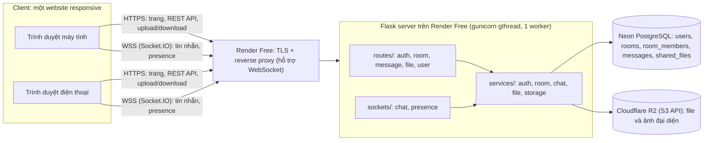
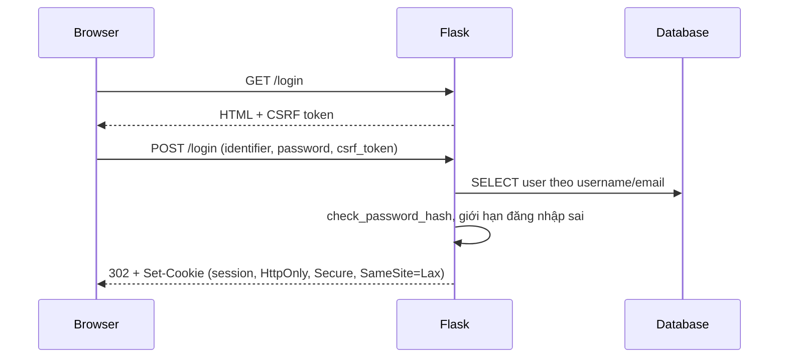
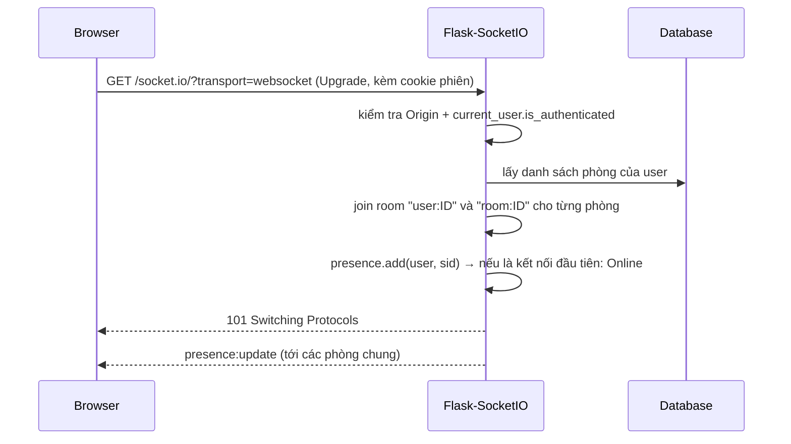
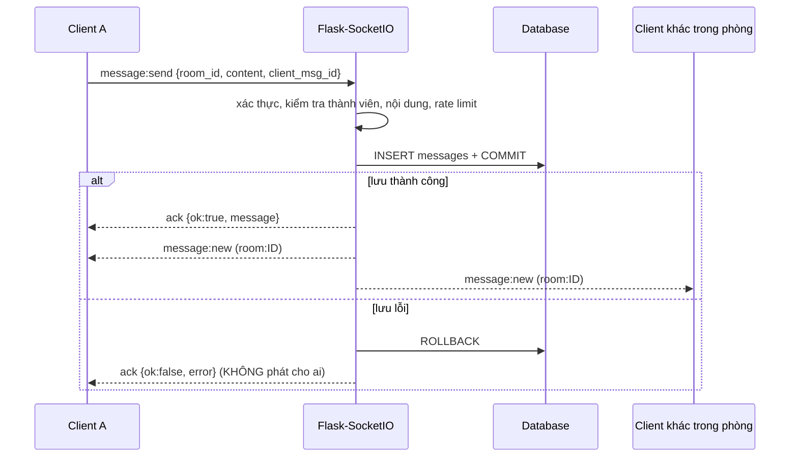
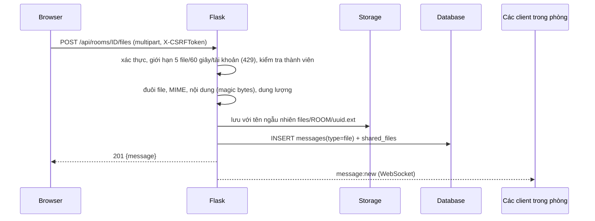
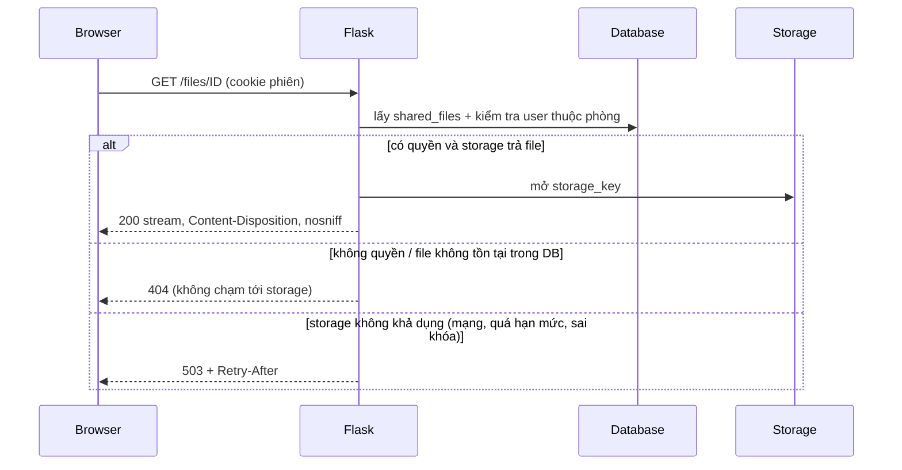
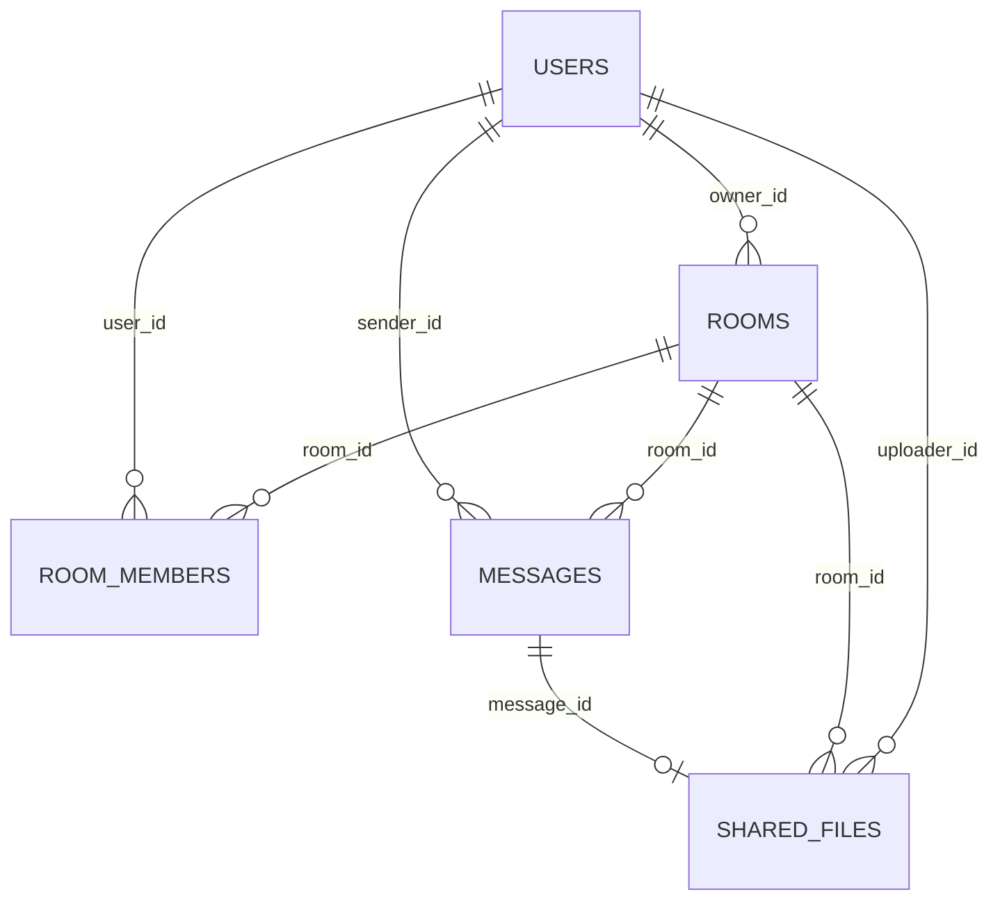

# Kiến trúc ConnectHub

## 1. Tổng quan Client – Server

| Thành phần | Vai trò | Nơi đặt |
|---|---|---|
| GitHub | Lưu source code | github.com |
| Hosting | Chạy Flask + WebSocket | Render Web Service (Free) |
| Database | Lưu user, phòng, tin nhắn, metadata file | Neon PostgreSQL (Free) |
| File Storage | Lưu nội dung file/ảnh đại diện | Cloudflare R2 (free tier) |

## 2. Sơ đồ tuần tự

### Đăng nhập

### Kết nối WebSocket

### Gửi tin nhắn

### Upload file

### Download file

## 3. Cơ sở dữ liệu

Tất cả khóa ngoại dùng `ON DELETE CASCADE`. Index chính: `messages(room_id, id)`, `room_members(user_id)`, `shared_files(room_id, created_at)`, unique `invite_code`, `username`, `email`, `(room_id, user_id)`, `(sender_id, client_msg_id)`.
